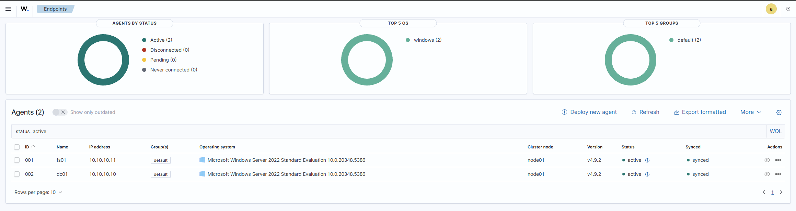
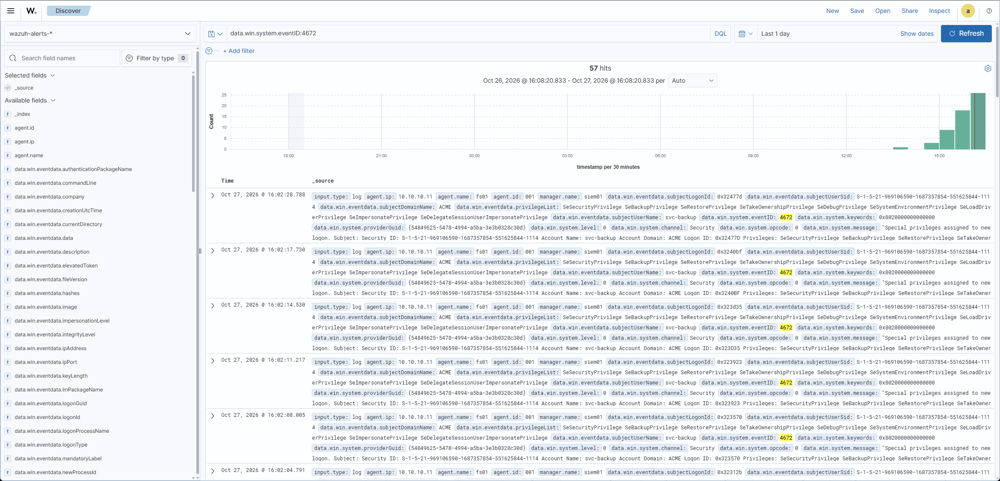
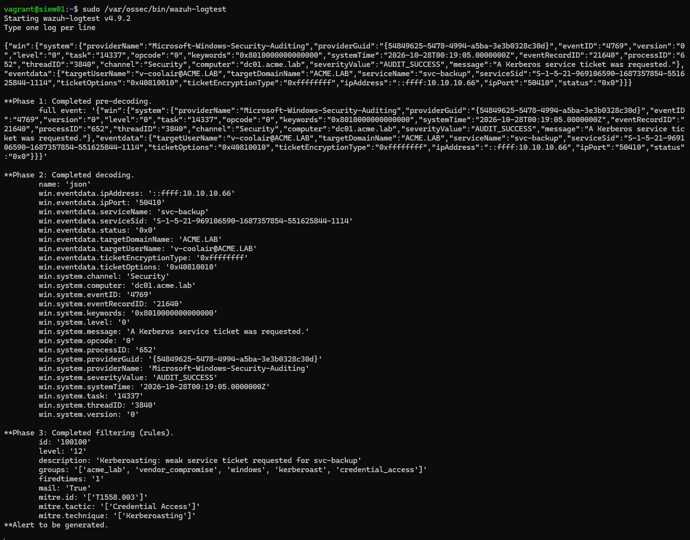

# Third-Party Credential Compromise: Attack & Defense Lab

Simulating the theft and abuse of a vendor's credentials against an enterprise,
then building the controls and detections that stop it. Maps to MITRE ATT&CK
**T1078 (Valid Accounts)** and **T1199 (Trusted Relationship)** — the pattern
behind the 2013 Target breach and the 2024 Snowflake-related intrusions.

> **One-line result:** A stolen HVAC-vendor password was chained all the way to
> administrator access on the file server and theft of sensitive financial data —
> completely undetected by the baseline SIEM. After building detections, the same
> Kerberoasting step that was invisible now fires a **level-12 alert** mapped to
> MITRE **T1558.003**, validated against a real event.

<!-- IMAGE: wazuh-agents-active.png — both endpoints enrolled and reporting; proves the monitoring pipeline works end to end -->

*The lab, built and monitored: dc01 and fs01 enrolled and actively reporting to Wazuh.* 

## The scenario

**Acme Widgets** (fictional) outsources HVAC monitoring to **CoolAir HVAC**, a
vendor with a remote-access account. An infostealer harvests that account's
password. This lab plays out what happens next — first against a typical weak
baseline, then against a hardened one.

## The result: before vs. after

The whole point of the project in two images — the same attack activity, before
and after detections were built.

**Before — the attack is logged but nothing alerts.** The stolen vendor
credential authenticates and Kerberoasting runs; the SIEM records the events at
level 0 and no analyst is ever notified.

<!-- IMAGE: 01-baseline-vendor-logon-logged-not-alerted.png — vendor logon captured from the attacker IP, logged but not alerted -->

*Before: the vendor credential logs in from the attacker host (10.10.10.66). Logged, never alerted.*

<!-- IMAGE: 04-baseline-kerberoast-logged.png — the 4769 Kerberoast event sitting silently in the logs -->
 
*Before: the Kerberoast 4769 event is recorded but triggers no alert.*

**After — the same Kerberoast fires a high-severity alert.** A tuned Wazuh rule
matches the real event and generates a level-12 alert tagged to MITRE
T1558.003.

<!-- IMAGE: 05-detection-kerberoast-fires.png — wazuh-logtest showing rule 100100 matching the real Kerberoast event at level 12 -->
 
*After: the same event now matches rule 100100 (level 12, T1558.003) — "Alert to be generated."* 

## The attack chain

One stolen HVAC-vendor password → full file-server compromise, proven end to end.

<!-- IMAGE: 02-svc-account-cracked-fs01-pwned.png — Kerberoast crack + Pwn3d! on fs01 + exposed shares -->
 
*The escalation: the Kerberoasted service account is cracked and grants admin (Pwn3d!) on fs01, exposing the Finance/HR shares.* 

<!-- IMAGE: 03-exfiltrated-finance-data.png — the exfiltrated vendor_payments_2026.csv (fake, clearly-labeled data) -->
 
*The payoff: sensitive (fake) financial data read and exfiltrated by the compromised service account.* 

## Phases

| Phase | What happens | Status |
|-------|--------------|--------|
| 1 | Build the vulnerable corporate baseline | **built & verified** |
| 2 | Attack with the stolen vendor credential; show the SIEM sees almost nothing | **executed end to end** |
| 3 | Harden (least privilege, JIT, AES, honeytoken) + detections & hunts | **detections verified firing** |
| 4 | Re-attack; measure what's blocked, what's detected, how fast | in progress |

## Deliverables

- **Threat-hunting & detection report** — the attack (`attack/`), hypothesis-driven hunts (`hunts/`), Sigma + Wazuh rules (`detections/`)
- **Attack-surface write-up** — before vs. after hardening (`docs/attack-surface-analysis.md`)
- **Third-party risk assessment** — executive-facing, NIST CSF 2.0 + 800-53 (`risk-assessment/`)
- **Incident response playbook** — suspected compromised third-party credential (`playbooks/`)

See `AI_USAGE.md` for a transparent account of what was AI-assisted and the real
bugs I caught and fixed while building it.

## Lab topology

```
VirtualBox internal network "acme-corp" — 10.10.10.0/24 (isolated)
  dc01    10.10.10.10   Windows Server 2022   AD DS, DNS (acme.lab)
  fs01    10.10.10.11   Windows Server 2022   File shares + fake data
  siem01  10.10.10.20   Ubuntu 22.04          Wazuh (indexer/manager/dashboard)
  kali    10.10.10.66   Kali Linux            Attacker (Phase 2)
```

Windows hosts run Sysmon (SwiftOnSecurity config) and the Wazuh agent.

## Requirements

- VirtualBox 7.x, Vagrant 2.4+, ~16 GB RAM free, ~60 GB disk
- `vagrant plugin install vagrant-reload`

New to this? See `GETTING_STARTED.md` for a plain-language walkthrough.

## Build it

```bash
cd lab
vagrant up siem01          # bring the SIEM up first so agents can enroll
vagrant up dc01            # promotes to DC, reboots, builds the directory
vagrant up fs01            # joins the domain, creates shares + fake data
vagrant up kali            # attacker (Phase 2)
```

Wazuh dashboard: `https://127.0.0.1:8443` (credentials in `lab/.secrets/`,
which is git-ignored). Confirm `dc01` and `fs01` show as active agents.

Then seed the attack path before Phase 2 (elevated PowerShell on each host, or via
`vagrant winrm`):

```
C:\vagrant\scripts\dc01\03-seed-attack-paths.ps1   # on dc01
C:\vagrant\scripts\fs01\03-seed-localadmin.ps1     # on fs01
```

> If the Kali attacker can't reach `10.10.10.0/24` on first boot, run
> `vagrant reload kali` once — its internal adapter needs a reboot to attach.

## Safety

This environment is **intentionally vulnerable** and contains only fake,
clearly-labeled data. Keep it on the isolated internal network. Never bridge it
to a real network, and never reuse these lab passwords anywhere.

## Repository layout

```
lab/            Vagrantfile + provisioning scripts
attack/         Attack chain scripts + manual runbook
detections/     Sigma rules + Wazuh rule translations (verified firing)
hunts/          Hypothesis-driven threat hunts
harden/         Remediation scripts (Phase 3)
playbooks/      Incident response
risk-assessment/  NIST-mapped vendor access risk assessment
docs/           Baseline weaknesses, attack-surface analysis, lab notes, images
```

## Credits

Built with open-source tooling: Wazuh, Sysmon, the SwiftOnSecurity Sysmon
config, NetExec, Impacket, John the Ripper, and the Sigma project. Detections
reference the MITRE ATT&CK framework. Built with AI assistance (see `AI_USAGE.md`).
