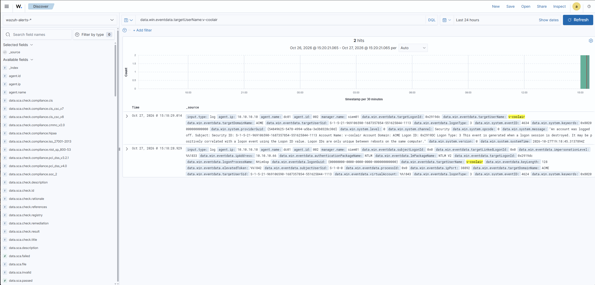

# Lab note — Phase 2: attack against the baseline

**Date:** 2026-10-28
**VMs / tools:** kali (nxc/NetExec, impacket, john, smbclient), dc01, fs01, siem01

## Objective
Run the full stolen-credential attack chain against the UNHARDENED baseline and
record what Wazuh did and did not detect, step by step.

## Result: the attack succeeded end to end, fully logged, zero alerts

Confirmed in Wazuh Discover (79 hits for the attacker accounts in the attack
window, all at rule level 0 — logged, never escalated to an alert).

| Step | Technique | ATT&CK | Caught at baseline? | Event IDs confirmed in Wazuh |
|------|-----------|--------|---------------------|------------------------------|
| 1 Recon / valid-account logon | Valid Accounts | T1078.002 | No — logged only | 4624/4634 for v-coolair from 10.10.10.66 (NTLM, type 3) |
| 2 Kerberoast | Steal/Forge Kerberos Tickets | T1558.003 | No — logged only | 4769 for svc-backup SPN, ticketEncryptionType `0xffffffff` |
| 3 Lateral movement (admin on fs01) | Remote Services / Valid Accounts | T1021 / T1078.002 | No — logged only | 4624 type 3 + 4672 (57 special-privilege events) for svc-backup on fs01 |
| 4 Collection / exfiltration | Data from Network Shared Drive | T1039 | No — logged only | Finance share read (vendor_payments_2026.csv) |

Every "No" in this table becomes a detection in Phase 3.

## Evidence (screenshots)

<!-- IMAGE: 01-baseline-vendor-logon-logged-not-alerted.png -->

Step 1: v-coolair authenticates from the attacker host; logged, no alert.

<!-- IMAGE: 02-svc-account-cracked-fs01-pwned.png -->
 
Steps 2-3: Kerberoast cracked, admin (Pwn3d!) on fs01, Finance/HR shares exposed. 

<!-- IMAGE: 03-exfiltrated-finance-data.png -->
 
Step 4: sensitive (fake) financial data read and exfiltrated. 

<!-- IMAGE: 04-baseline-kerberoast-logged.png -->
 
-- Step 2 in the SIEM: the 4769 event recorded but not alerted at baseline. 

## Notes / things learned
- The recon logon is **NTLM, logon type 3** because nxc authenticated by IP
  (forces NTLM rather than Kerberos).
- The Kerberoast ticket reported `ticketEncryptionType = 0xffffffff`, not the
  textbook `0x17` — this mattered later when tuning the detection.
- Offline cracking (john) and the cracked password are **invisible** to the SIEM;
  the only network-visible trace of the whole Kerberoast is the single 4769.

## Cleanup done?
- [ ] Removed scheduled task `AcmeUpdater` on fs01 (if persistence step was run)
- [ ] Removed local account `svc-helpdesk` on fs01 (if persistence step was run)
